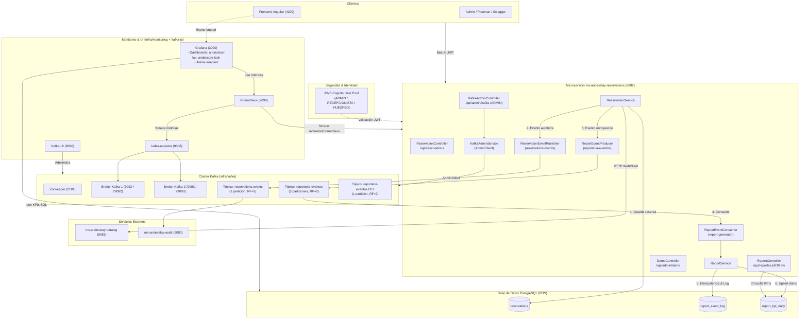

# ms-andesstay-reservations — Entrega 3 (Kafka + Reportería en Tiempo Real)

Microservicio de reservas y reportería analítica del caso **AndesStay** (DSY1107 — Arquitectura de Sistemas Distribuidos, Duoc UC).

Este microservicio gestiona el ciclo de vida completo de las reservas y provee **reportería analítica en tiempo real basada en eventos con Apache Kafka**, persistencia en **PostgreSQL (RDS)**, monitoreo con **Prometheus y Grafana**, y un módulo de **administración dinámica de tópicos Kafka**.

---

## 1. Arquitectura del Sistema (Entrega 3)



---

## 2. Flujo Paso a Paso de Reportería en Tiempo Real

1. **Autenticación**: El usuario (huésped o recepcionista) obtiene su JWT desde AWS Cognito. Si es un usuario recién registrado sin grupos asignados, el microservicio le asigna automáticamente `ROLE_HUESPED`.
2. **Creación o Cambio de Estado**: Se invoca un endpoint (`POST /api/reservations`, `confirmar`, `checkin`, `checkout`, `cancelar`).
3. **Validación de Disponibilidad**: Se consulta `ms-andesstay-catalog` mediante WebClient para verificar existencia, precio y capacidad.
4. **Persistencia en Postgres**: Se guarda la reserva en la tabla `reservations`.
5. **Publicación en Kafka (Audit)**: Tras el commit exitoso de la transacción, se emite el evento base en `reservations.events` con clave = `reservationId`. `ms-andesstay-audit` lo consume sin alteraciones en su contrato.
6. **Publicación en Kafka (Reportería)**: En paralelo, se publica el evento enriquecido `ReportEventMessage` en `reporteria-eventos` (3 particiones, clave = `reservationId`), incluyendo noches, precio unitario, precio total y estado.
7. **Consumo Asíncrono e Idempotente**: `ReportEventConsumer` (grupo `report-generator`) recibe el mensaje. Valida en `report_event_log` que `eventId` no exista previamente.
8. **Agregación en `report_kpi_daily`**: Se ejecuta un *upsert* en la misma transacción actualizando los contadores y montos acumulados por fecha y unidad.
9. **Visualización en Grafana**: Grafana consulta `report_kpi_daily` cada 5 segundos y actualiza el dashboard `andesstay-kpi` embebido en Angular sin recargar la página.

---

## 3. Stack Tecnológico

- **Lenguaje**: Java 21 (LTS).
- **Framework**: Spring Boot 3.3.4.
- **Persistencia**: Spring Data JPA / Hibernate, PostgreSQL (soporta RDS en AWS), H2 (para tests aislados).
- **Streaming & Eventos**: Apache Kafka 3.7 / Confluent Platform 7.6.1 (2 brokers + Zookeeper).
- **Seguridad**: Spring Security 6.3, OAuth2 Resource Server con JWT (AWS Cognito), CORS parametrizado.
- **Métricas & Monitoreo**: Spring Boot Actuator, Micrometer Prometheus Registry, Prometheus v2.52, Grafana v10.4, Kafka-Exporter v1.7.
- **Herramientas de Gestión**: Kafka-UI v0.7.2, Springdoc OpenAPI 2.6 (Swagger UI).
- **Contenedores**: Docker multi-stage build, Docker Compose v2.

---

## 4. Reglas de Negocio de los KPIs

| KPI | Tabla / Fuente | Fórmula / Regla |
|---|---|---|
| **Reservas Creadas** | `report_kpi_daily.reservas_creadas` | Contador de eventos `RESERVA_CREADA`. |
| **Reservas Confirmadas** | `report_kpi_daily.confirmadas` | Contador de eventos `RESERVA_CONFIRMADA`. |
| **Check-ins** | `report_kpi_daily.checkins` | Contador de eventos `RESERVA_CHECKIN`. |
| **Check-outs** | `report_kpi_daily.checkouts` | Contador de eventos `RESERVA_CHECKOUT`. |
| **Canceladas** | `report_kpi_daily.canceladas` | Contador de eventos `RESERVA_CANCELADA`. |
| **Ingresos Confirmados** | `report_kpi_daily.ingresos_confirmados` | Suma de `total_price` de eventos `RESERVA_CONFIRMADA`. |
| **Noches Reservadas** | `report_kpi_daily.noches_reservadas` | Suma de `nights` de eventos creados. |
| **Tasa de Cancelación** | API `/api/reportes/kpi/resumen` | `canceladas / reservas_creadas` (en porcentaje). |
| **Ticket Promedio** | API `/api/reportes/kpi/resumen` | `ingresos_confirmados / confirmadas`. |

---

## 5. Endpoints de la API y Roles Requeridos

### 5.1 Reservas (`/api/reservations`)

| Método | Endpoint | Rol Requerido | Descripción |
|---|---|---|---|
| `POST` | `/api/reservations` | `ADMIN`, `RECEPCIONISTA`, `HUESPED` | Crea reserva para el usuario autenticado (`sub` del JWT). |
| `GET` | `/api/reservations` | `ADMIN`, `RECEPCIONISTA` | Listado paginado con filtros (`guestId`, `unitId`, `estado`, fechas). |
| `GET` | `/api/reservations/mias` | Cualquier autenticado | Lista reservas del huésped autenticado. |
| `GET` | `/api/reservations/{id}` | `ADMIN`, `RECEPCIONISTA` o dueño | Detalle de la reserva. |
| `PUT` | `/api/reservations/{id}/confirmar` | `ADMIN`, `RECEPCIONISTA` | Pasa a estado `CONFIRMADA`. |
| `PUT` | `/api/reservations/{id}/checkin` | `ADMIN`, `RECEPCIONISTA` | Pasa a estado `CHECKIN`. |
| `PUT` | `/api/reservations/{id}/checkout` | `ADMIN`, `RECEPCIONISTA` | Pasa a estado `CHECKOUT`. |
| `PUT` | `/api/reservations/{id}/cancelar` | `ADMIN`, `RECEPCIONISTA` o dueño | Cancela reserva (solo en `PENDIENTE` o `CONFIRMADA`). |
| `DELETE` | `/api/reservations/{id}` | `ADMIN` | Eliminación física de la reserva. |

### 5.2 Reportería Analítica (`/api/reportes`) — Solo `ADMIN`

| Método | Endpoint | Rol | Descripción |
|---|---|---|---|
| `GET` | `/api/reportes/kpi/resumen` | `ADMIN` | Totales: creadas, confirmadas, canceladas, ingresos, tasa cancelación, ticket promedio. |
| `GET` | `/api/reportes/kpi/diario?desde&hasta` | `ADMIN` | Serie temporal diaria de KPIs. |
| `GET` | `/api/reportes/kpi/por-unidad` | `ADMIN` | Ranking de unidades por volumen de ingresos. |
| `GET` | `/api/reportes/eventos?type` | `ADMIN` | Últimos eventos procesados en el log de reportería. |

### 5.3 Microservicio Administrador de Kafka (`/api/admin/kafka`) — Solo `ADMIN`

| Método | Endpoint | Rol | Descripción |
|---|---|---|---|
| `GET` | `/api/admin/kafka/topics` | `ADMIN` | Lista todos los tópicos con particiones y réplicas. |
| `GET` | `/api/admin/kafka/topics/{nombre}` | `ADMIN` | Detalle del tópico, réplicas, ISR y configuraciones. |
| `POST` | `/api/admin/kafka/topics` | `ADMIN` | Crea un tópico dinámicamente con validación. |
| `PUT` | `/api/admin/kafka/topics/{nombre}/config` | `ADMIN` | Modifica configuraciones (`retention.ms`, etc.). |
| `PUT` | `/api/admin/kafka/topics/{nombre}/partitions` | `ADMIN` | Aumenta el número de particiones (no permite reducir). |
| `DELETE` | `/api/admin/kafka/topics/{nombre}` | `ADMIN` | Elimina tópico (tópicos protegidos requieren `?force=true`). |
| `GET` | `/api/admin/kafka/consumer-groups` | `ADMIN` | Lista consumer groups y su lag estimado. |

### 5.4 Demo y Actuator

| Método | Endpoint | Rol / Acceso | Descripción |
|---|---|---|---|
| `POST` | `/api/admin/demo/generar?cantidad=N` | `ADMIN` (`DEMO_ENABLED=true`) | Genera N eventos sintéticos realistas en Kafka. |
| `DELETE` | `/api/admin/demo/limpiar` | `ADMIN` (`DEMO_ENABLED=true`) | Elimina los eventos y KPIs de demostración. |
| `GET` | `/actuator/health` | Público | Verificación de salud y liveness/readiness probes. |
| `GET` | `/actuator/prometheus` | Público (restringido en red) | Métricas formato Prometheus para scraping. |
| `GET` | `/swagger-ui.html` | Público | Documentación interactiva de OpenAPI. |

---

## 6. Variables de Entorno

| Variable | Descripción | Valor Ejemplo Local | Obligatoria |
|---|---|---|:---:|
| `SERVER_PORT` | Puerto HTTP del microservicio | `8082` | No (default 8082) |
| `DB_URL` | URL JDBC de PostgreSQL | `jdbc:postgresql://localhost:5432/andesstay_reservations` | Sí |
| `DB_USERNAME` | Usuario de PostgreSQL | `postgres` | Sí |
| `DB_PASSWORD` | Contraseña de PostgreSQL | `postgres` | Sí |
| `JPA_DDL_AUTO` | Estrategia DDL de Hibernate | `update` | No |
| `JPA_SHOW_SQL` | Log de sentencias SQL | `false` | No |
| `CATALOG_SERVICE_URL` | URL de `ms-andesstay-catalog` | `http://localhost:8081` | No |
| `KAFKA_BOOTSTRAP_SERVERS` | Direcciones de brokers Kafka | `localhost:9092,localhost:9093` | Sí |
| `KAFKA_ADVERTISED_HOST` | Host público reportado por Kafka | `localhost` (en EC2: IP pública) | Sí |
| `REPORT_TOPIC` | Tópico de eventos de reportería | `reporteria-eventos` | No |
| `REPORT_GROUP_ID` | Grupo de consumidores de reporte | `report-generator` | No |
| `REPORT_TOPIC_REPLICAS` | Factor de réplica del tópico | `1` en local, `2` en cluster Docker | No |
| `COGNITO_REGION` | Región AWS del User Pool | `us-east-1` | Sí (excepto nosec) |
| `COGNITO_USER_POOL_ID` | ID del User Pool Cognito | `us-east-1_xxxxxxxxx` | Sí (excepto nosec) |
| `COGNITO_APP_CLIENT_ID` | Client ID de la App Cognito | `xxxxxxxxxxxxxxxxxxxxxxxxxx` | Sí (excepto nosec) |
| `DEFAULT_ROLE` | Rol default para usuario sin grupo | `HUESPED` | No |
| `CORS_ALLOWED_ORIGINS` | Orígenes permitidos por CORS | `http://localhost:4200` | No |
| `DEMO_ENABLED` | Habilita endpoints de datos demo | `true` (en local/demo) | No |
| `KAFKA_UI_USER` | Usuario admin de Kafka-UI | `admin` | No |
| `KAFKA_UI_PASSWORD` | Contraseña de Kafka-UI | `changeme123` | No |
| `GF_SECURITY_ADMIN_PASSWORD`| Contraseña admin de Grafana | `admin123` | No |
| `GF_DB_HOST` | Host Postgres para Grafana | `localhost:5432` | No |

---

## 7. Guía de Ejecución Paso a Paso en Local

### Paso 0: Prerrequisitos
- Docker Engine y Docker Compose instalados.
- Java 21 y Maven 3.9+ (o usar wrapper `./mvnw` / Maven incluido).

### Paso 1: Crear la red Docker compartida
Todos los contenedores se comunican a través de la red `andesstay-net`:
```bash
docker network create andesstay-net
```

### Paso 2: Levantar el cluster Kafka (Zookeeper + 2 brokers)
```bash
cd infra/kafka
docker-compose up -d
# Esperar que kafka-init cree los tópicos reservations.events y reporteria-eventos
```

### Paso 3: Levantar Kafka-UI
```bash
cd ../kafka-ui
docker-compose up -d
# Disponible en: http://localhost:8090 (Usuario: admin, Clave: changeme123)
```

### Paso 4: Levantar Monitoreo (Prometheus + Grafana + Exporter)
```bash
cd ../monitoring
docker-compose up -d
# Prometheus: http://localhost:9090
# Grafana:    http://localhost:3000 (Usuario: admin, Clave: admin123)
```

### Paso 5: Levantar Base de Datos PostgreSQL local (si no se usa RDS)
```bash
docker run -d --name andesstay-postgres \
  --network andesstay-net \
  -p 5432:5432 \
  -e POSTGRES_DB=andesstay_reservations \
  -e POSTGRES_USER=postgres \
  -e POSTGRES_PASSWORD=postgres \
  postgres:15-alpine
```

### Paso 6: Ejecutar el microservicio de reservas
```bash
# Opción A: Mediante Maven local (con perfil nosec para probar sin Cognito real):
mvn spring-boot:run -Dspring-boot.run.profiles=nosec

# Opción B: Mediante Docker Compose:
docker-compose -f docker-compose.app.yml up -d --build
```

---

## 8. Cómo Demostrar la Reportería en Vivo

1. **Generar Eventos de Prueba**:
   Con el servicio corriendo con `DEMO_ENABLED=true`, ejecute:
   ```bash
   curl -X POST "http://localhost:8082/api/admin/demo/generar?cantidad=40"
   ```
2. **Verificar en Kafka-UI**:
   - Ingrese a `http://localhost:8090`.
   - Ingrese al tópico `reporteria-eventos` > pestaña **Messages**. Verifique que los 40 mensajes están distribuidos en las 3 particiones con sus keys correspondientes (`reservationId`).
3. **Verificar en Grafana**:
   - Ingrese a `http://localhost:3000/d/andesstay-kpi/andesstay-reporteria-kpi`.
   - Observe los KPIs de Ingresos Totales, Reservas Creadas, Gráfico de Ingresos por Día y Ranking de Unidades actualizándose en tiempo real.
4. **Verificar Métricas Técnicas**:
   - Ingrese a `http://localhost:3000/d/andesstay-tech/andesstay-metricas-tecnicas`.
   - Observe la memoria JVM, requests HTTP por segundo y la tasa de eventos Kafka publicados y consumidos.
5. **Limpiar Datos Demo**:
   ```bash
   curl -X DELETE "http://localhost:8082/api/admin/demo/limpiar"
   ```

---

## 9. Integración con Frontend Angular (iframe)

Grafana está preconfigurado en `infra/monitoring/docker-compose.yml` con:
- `GF_SECURITY_ALLOW_EMBEDDING=true`: Permite renderizar paneles en etiquetas `<iframe>`.
- `GF_AUTH_ANONYMOUS_ENABLED=true`: Acceso directo de solo lectura con rol `Viewer`.
- `GF_SECURITY_COOKIE_SAMESITE=disabled`: Evita bloqueos de cookies entre orígenes distintos.

### URL para embeber en el template de Angular:
```html
<iframe
  src="http://localhost:3000/d/andesstay-kpi/andesstay-reporteria-kpi?orgId=1&kiosk&theme=dark&refresh=5s"
  width="100%"
  height="800px"
  frameborder="0">
</iframe>
```

---

## 10. Flujo de Trabajo Git (Git Flow)

Para mantener la trazabilidad y buenas prácticas de ingeniería en el equipo:

- `main`: Rama de producción (código estable desplegable en AWS).
- `develop`: Rama principal de integración y desarrollo.
- `feature/*`: Ramas de características individuales trabajadas por cada integrante.

### Commits Sugeridos por Fase (Conventional Commits):
- `feat(base): upgrade to Java 21 and add actuator prometheus dependencies`
- `feat(kafka): implement ReportEventMessage, producer and topics configuration`
- `feat(consumer): implement ReportEventConsumer with idempotency and DLT error handler`
- `feat(model): add report_event_log and report_kpi_daily entities and repositories`
- `feat(api): create ReportController and demo data generator for KPI visualization`
- `feat(admin): implement KafkaAdminService and KafkaAdminController for topic management`
- `feat(infra): add docker-compose for kafka cluster, kafka-ui and monitoring`
- `feat(security): configure Cognito default role HUESPED, CORS and TraceId filter`
- `test(unit): add comprehensive unit and embedded kafka integration tests`
- `docs: add AWS deployment guide, presentation script and updated README`
