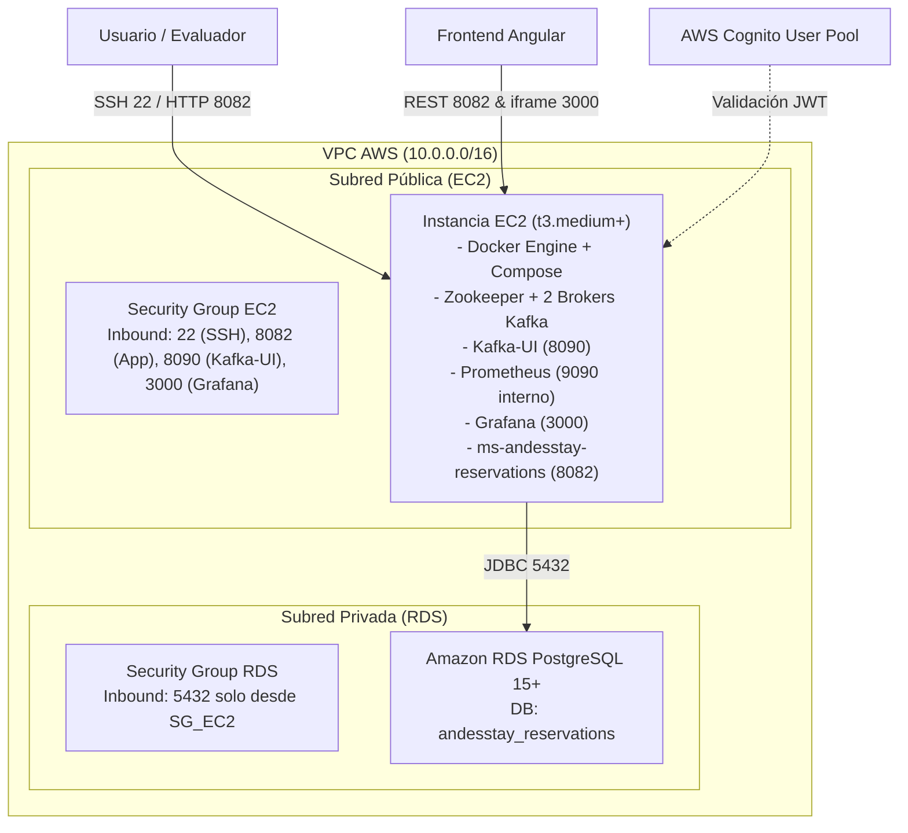

# Guía de Despliegue en AWS: EC2 + RDS + Kafka + Monitoreo

Este documento describe la arquitectura y los pasos para el despliegue manual de **ms-andesstay-reservations** en AWS para la Entrega 3 de DSY1107.

> **IMPORTANTE**: Este archivo es de preparación técnica. Todo está parametrizado por variables de entorno y no contiene secretos ni dependencias con cuentas específicas.

---

## 1. Arquitectura en AWS



---

## 2. Checklist "Antes de Desplegar desde otra Cuenta AWS"

Antes de ejecutar el despliegue en su cuenta AWS personal o institucional, verifique y reemplace los siguientes parámetros en su archivo `.env`:

| Variable | Descripción | Valor sugerido en AWS |
|---|---|---|
| `DB_URL` | Endpoint de RDS PostgreSQL | `jdbc:postgresql://<rds-endpoint>:5432/andesstay_reservations` |
| `DB_USERNAME` | Usuario maestro de RDS | Configurado al crear la instancia RDS |
| `DB_PASSWORD` | Contraseña maestra de RDS | Contraseña segura definida en RDS |
| `KAFKA_ADVERTISED_HOST` | IP pública o DNS público de EC2 | IP pública elástica o asignada a la EC2 |
| `COGNITO_REGION` | Región AWS de Cognito | `us-east-1` (o su región) |
| `COGNITO_USER_POOL_ID` | ID del User Pool de Cognito | `us-east-1_xxxxxxxxx` |
| `COGNITO_APP_CLIENT_ID` | Client ID de la app Cognito | Cadena alfanumérica de 26 caracteres |
| `DEFAULT_ROLE` | Rol para usuarios sin grupo | `HUESPED` |
| `CORS_ALLOWED_ORIGINS` | Origen del Frontend Angular | `http://localhost:4200,http://<ip-frontend>:4200` |
| `KAFKA_UI_PASSWORD` | Contraseña básica de Kafka-UI | Contraseña segura |
| `GF_SECURITY_ADMIN_PASSWORD` | Contraseña admin de Grafana | Contraseña segura |
| `GF_DB_HOST` | Host RDS para Grafana | `<rds-endpoint>:5432` |

---

## 3. Paso a Paso: Creación de Infraestructura AWS

### Paso 1: Crear Security Groups

1. **Security Group para RDS (`sg-andesstay-rds`)**:
   - **Inbound Rules**:
     - Tipo: `PostgreSQL` (Puerto 5432)
     - Origen: ID del Security Group de EC2 (`sg-andesstay-ec2`) o CIDR de la VPC.

2. **Security Group para EC2 (`sg-andesstay-ec2`)**:
   - **Inbound Rules**:
     - `SSH (22)`: Solo desde su IP pública actual (`Mi IP`).
     - `Custom TCP (8082)`: API REST microservicio reservas (Público o IP frontend).
     - `Custom TCP (8090)`: Kafka-UI para administración (Restringido a IPs del equipo/evaluador).
     - `Custom TCP (3000)`: Grafana Dashboards para embedding iframe (Público o IP frontend).
     - `Custom TCP (9092, 9093)`: Broker Kafka EXTERNAL (Solo si otros servicios consumen desde fuera).
   - **Reglas Restringidas / Cerradas al público**:
     - Puerto `9090` (Prometheus) y `9308` (Kafka-exporter): **NO** deben exponerse a `0.0.0.0/0`.

### Paso 2: Crear Amazon RDS PostgreSQL

1. Ir a **Amazon RDS** > **Create database**.
2. **Motor**: PostgreSQL (versión 15.x o superior).
3. **Plantilla**: Free Tier o Dev/Test.
4. **Identificador**: `andesstay-reservations-db`.
5. **Usuario maestro**: `postgres`.
6. **Autenticación**: Contraseña.
7. **Instancia**: `db.t3.micro` o `db.t4g.micro`.
8. **Conectividad**:
   - VPC: Misma VPC que la instancia EC2.
   - Acceso público: *No* (recomendado) si EC2 está en la misma VPC.
   - Security Group: Seleccionar `sg-andesstay-rds`.
9. **Configuración inicial de base de datos**:
   - Nombre de la base de datos inicial: `andesstay_reservations`.

### Paso 3: Lanzar Instancia EC2

1. Ir a **Amazon EC2** > **Launch Instance**.
2. **Nombre**: `andesstay-reservations-host`.
3. **AMI**: Amazon Linux 2023 AMI (x86_64) o Ubuntu 22.04 LTS.
4. **Tipo de instancia**: **`t3.medium`** o superior (mínimo 2 vCPU y 4 GB RAM para soportar Zookeeper, 2 brokers Kafka, Kafka-UI, Prometheus, Grafana y la app).
5. **Par de claves (Key pair)**: Seleccione su clave `.pem` para acceso SSH.
6. **Configuración de red**:
   - VPC: Misma VPC que RDS.
   - Subred: Pública con auto-assign Public IP habilitado.
   - Security Group: Seleccionar `sg-andesstay-ec2`.
7. **Almacenamiento**: Mínimo 25 GB gp3.

---

## 4. Despliegue en la Instancia EC2

Conéctese a la instancia vía SSH:

```bash
ssh -i "su-llave.pem" ec2-user@<IP_PUBLICA_EC2>
```

### Opción A: Usar el script automatizado (Recomendado)

El repositorio incluye el script `scripts/deploy-ec2.sh` preparado para instalar dependencias y levantar todos los servicios:

```bash
# Clonar el proyecto
git clone https://github.com/tu-organizacion/ms-andesstay-reservations.git
cd ms-andesstay-reservations

# Dar permisos de ejecución
chmod +x scripts/deploy-ec2.sh

# Ejecutar despliegue con la IP pública de la instancia
KAFKA_ADVERTISED_HOST="<IP_PUBLICA_EC2>" ./scripts/deploy-ec2.sh
```

### Opción B: Despliegue manual paso a paso

1. **Crear la red Docker compartida**:
   ```bash
   docker network create andesstay-net
   ```

2. **Configurar `.env`**:
   ```bash
   cp infra/.env.example .env
   nano .env
   # Completar DB_URL con el endpoint de RDS, KAFKA_ADVERTISED_HOST con la IP pública,
   # y las credenciales de Cognito.
   ```

3. **Levantar Kafka (Zookeeper + 2 brokers + init)**:
   ```bash
   cd infra/kafka
   docker compose --env-file ../../.env up -d
   ```

4. **Levantar Kafka-UI**:
   ```bash
   cd ../kafka-ui
   docker compose --env-file ../../.env up -d
   ```

5. **Levantar Prometheus + Grafana**:
   ```bash
   cd ../monitoring
   docker compose --env-file ../../.env up -d
   ```

6. **Compilar y levantar el microservicio de reservas**:
   ```bash
   cd ../..
   docker compose -f docker-compose.app.yml --env-file .env up -d --build
   ```

---

## 5. Verificación del Despliegue

Ejecutar las siguientes pruebas desde su terminal local o navegador:

1. **Healthcheck del Microservicio**:
   ```bash
   curl -i http://<IP_PUBLICA_EC2>:8082/actuator/health
   # Respuesta esperada: HTTP 200 {"status":"UP"}
   ```

2. **Métricas de Prometheus expuestas**:
   ```bash
   curl -s http://<IP_PUBLICA_EC2>:8082/actuator/prometheus | grep andesstay
   # Debe mostrar contadores andesstay_eventos_publicados_total, etc.
   ```

3. **Kafka-UI**:
   - Abrir en el navegador: `http://<IP_PUBLICA_EC2>:8090`
   - Ingresar credenciales (`KAFKA_UI_USER` / `KAFKA_UI_PASSWORD`).
   - Verificar: 2 brokers online, tópicos `reservations.events`, `reporteria-eventos` y `reporteria-eventos.DLT`.

4. **Grafana Dashboards**:
   - Abrir en el navegador: `http://<IP_PUBLICA_EC2>:3000`
   - Acceder al dashboard provisionado **"AndesStay - Reportería KPI"** (`uid: andesstay-kpi`).
   - Verificar que carga en modo kiosk / iframe sin requerir login si se activa el acceso anónimo.

5. **Generación de Datos Demo**:
   ```bash
   curl -X POST "http://<IP_PUBLICA_EC2>:8082/api/admin/demo/generar?cantidad=30" \
        -H "Authorization: Bearer <TOKEN_ADMIN_COGNITO>"
   # Los datos generados se consumen inmediatamente por Kafka y se reflejan en Grafana.
   ```

---

## 6. Capturas Sugeridas para la Entrega y Evaluación

1. **Consola AWS RDS**: Instancia PostgreSQL en estado *Available* con su endpoint y Security Group.
2. **Consola AWS EC2**: Instancia `t3.medium` en estado *Running* con sus Security Groups y puertos.
3. **Kafka-UI**: Vista de cluster mostrando los 2 brokers y los tópicos con 3 particiones y réplica factor 2.
4. **Grafana**: Dashboard `andesstay-kpi` mostrando los gráficos de ingresos, reservas por día y ranking de unidades actualizándose en tiempo real.
5. **Terminal / Postman**: Pruebas de API REST respondiendo 200 a ADMIN y 403 a HUESPED en `/api/reportes/**`.
